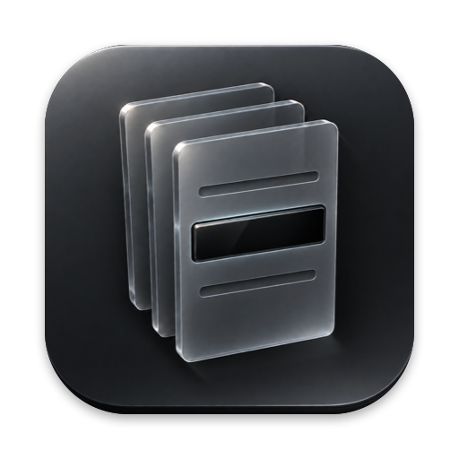

<p align="center"></p>

<h1 align="center">DocSan</h1>

<p align="center"><b>Review and redact company references in documents, locally on your Mac.</b></p>

<p align="center">
  <a href="LICENSE"></a>
  
  
  
</p>

DocSan helps you prepare Word files, PDFs and images for sharing. It applies a private company profile, proposes redactions, asks you to review uncertain content and checks the resulting file before export. Processing runs on your Mac, without cloud services or language models.

**Pre-release source.** Build it locally to evaluate it on made-up documents first. Human review remains necessary: OCR can miss text, identifying context can remain and a passing verifier is not a guarantee of anonymity. No signed app download is offered with this source release.

## Why DocSan

| Capability | How it works |
|---|---|
| **No cloud document processing** | The app runs in the App Sandbox without network entitlements. Its engine and helpers inherit that sandbox. You control where exported files are saved and shared. |
| **Local rules and OCR** | Matching uses your company profile, word lists and fixed rules. Apple Vision reads pictures locally; Tesseract provides a separate OCR pass. Neither OCR engine establishes that a document is safe to share. |
| **Useful document structure** | Supported Word formatting is rebuilt, including lists, tables, headers and footers. Charts and SmartArt become tables or lists. PDFs become flattened pages with a sanitized text layer; their original editability is lost. |
| **Checks before export** | A separate verifier checks the finished bytes, metadata and supported visual content. Canary tests check that specific inspection steps are working. The [limits](docs/limitations.md) explain what these checks cannot establish. |

## How it works

1. Drop Word files, PDFs, images or folders. DocSan copies them into its private storage.
2. It reads every part of each file. A part it does not recognise blocks the file instead of passing through.
3. It replaces the terms in your profile, plus email addresses, links, domains, phone numbers and people's names. Names in pictures and on PDF pages are masked, and logos in Word files are removed whole.
4. You see the document as pages, decide any unfamiliar words and confirm each picture's and each PDF page's masks. Your decisions are saved in the profile.
5. The verifier checks the output, and the exact verified bytes are exported to the folder you choose.

## Supported files

| Input | Output |
|---|---|
| Word: `.docx`, `.docm`, `.dotx`, `.dotm` | A fresh `.docx` with formatting kept |
| PDF: text, scanned and mixed pages | A fresh, flattened `.pdf`: each page a picture with names masked, under an invisible text layer of the sanitized text; metadata, annotations, form fields, attached files and scripts removed |
| Images: PNG, JPEG | The same format, masked, with all metadata removed |
| Pictures inside Word files, including Visio drawings pasted as EMF | Masked, or removed whole when they are logos |
| Charts and SmartArt inside Word files | A table of the chart's values and a list of the diagram's text |
| Legacy Word: `.doc`, `.rtf`, `.odt` | Not yet: save the file as `.docx` first |
| Encrypted PDFs, XFA forms, PDF portfolios | Not supported: remove the protection or print to PDF first |
| PowerPoint, Excel | Later |

The [DOCX component contract](docs/docx-component-contract.md), [PDF component contract](docs/pdf-component-contract.md) and [image component contract](docs/image-component-contract.md) list what happens to every part of a file.

## Requirements

- macOS 26 or later on Apple silicon.
- To build: Xcode 26, [uv](https://docs.astral.sh/uv/), [XcodeGen](https://github.com/yonaskolb/XcodeGen) and Tesseract from Homebrew.

## Try the synthetic example

The example contains invented names and needs no company documents, profile or account. From the repository root:

```bash
cd engine
uv sync --locked
uv run python ../examples/make_demo.py ../build/demo
uv run docsan run ../build/demo/input.docx --profile ../examples/profile.json --lexicon tests/fixtures/lexicon --private ../build/demo/private --out ../build/demo/export
```

The command writes a redacted Word file and a summary. The [example guide](examples/README.md) explains what to inspect. Generated documents and processing state stay outside the public source file set.

## Build and run

```bash
git clone https://github.com/PAAparaschivei/docsan.git
cd docsan/app
brew install uv xcodegen tesseract
uv python install 3.13
scripts/bundle-engine.sh
xcodegen generate
xcodebuild -project DocSan.xcodeproj -scheme DocSan -configuration Debug -derivedDataPath build/DerivedData build
open build/DerivedData/Build/Products/Debug/DocSan.app
```

`bundle-engine.sh` packs a relocatable Python runtime, the engine, the Vision helper and Tesseract with its English and French data into the app. Python runtime dependencies use `engine/uv.lock` and checked package hashes. Setup downloads dependencies; document processing is local. Builds are signed ad hoc for local evaluation. Before redistributing a built app, complete the dependency-notice and packaging checks in [THIRD-PARTY-NOTICES.md](THIRD-PARTY-NOTICES.md) and the [release guide](docs/releasing.md).

On first launch, create a company profile or import one, then drop your files.

## Company profile

The profile is a private JSON file that lists what to remove. It lives in the app's storage, never in this repository.

```json
{
  "format": "docsan-profile",
  "version": 1,
  "name": "Aurelan Group",
  "policy": "v1",
  "terms": [
    {"text": "Aurelan", "label": "CLIENT"},
    {"text": "AGL", "label": "CLIENT", "case_sensitive": true},
    {"text": "Elena Marchetti", "label": "PERSON"}
  ],
  "safe_words": ["Kubernetes"]
}
```

The review adds the words you classify, and exporting adds the fingerprints of logos you removed, so each document needs fewer decisions than the last.

## Command line

The engine also runs on its own, which is how the tests drive it:

```bash
cd engine
uv run docsan run INPUT... --profile PROFILE.json --out SHARE_FOLDER --lexicon WORDLISTS
uv run docsan verify FILE.docx --profile PROFILE.json   # also FILE.pdf, FILE.png or FILE.jpg
uv run pytest
```

## Limits

**DocSan gives no universal zero-leak guarantee.** Read the output before you share it.

- It removes what your profile lists and asks about unfamiliar words. A company name that is also an ordinary word passes unless the profile lists it.
- OCR can miss small, faint or stylised text in pictures. A logo inside a larger picture or on a PDF page needs a mask you draw.
- A PDF comes out as pictures of its pages: links, form fields and the original fonts are gone, and the text cannot be edited.
- Context can still point to a company: a country, a regulator or exact figures. DocSan flags these for review but does not remove them.
- Removing names does not lift confidentiality obligations or anonymise personal data.

## Documentation

| Document | What it covers |
|---|---|
| [Architecture](docs/architecture.md) | Intake, review, verification, storage and export boundaries |
| [Limitations](docs/limitations.md) | Coverage, review responsibilities and cases that can still identify a company |
| [DOCX component contract](docs/docx-component-contract.md) | What happens to each part of a Word file |
| [PDF component contract](docs/pdf-component-contract.md) | What happens to each part of a PDF, and how the flattened output is verified |
| [Image component contract](docs/image-component-contract.md) | How pictures are read, masked, removed and verified |
| [App](app/README.md) and [engine](engine/README.md) | Building, running and testing each half |
| [Release guide](docs/releasing.md) | Public source checks and the separate gates for app distribution |

## Contributing and security

Contributions are welcome; see [CONTRIBUTING.md](CONTRIBUTING.md). Never attach a real document, company profile or output to an issue: reproduce problems with a made-up file. To report a leak or a way around the release checks, follow [SECURITY.md](SECURITY.md) instead of opening an issue.

## License

DocSan is licensed under the [Apache License 2.0](LICENSE). See [NOTICE](NOTICE) for attribution and [THIRD-PARTY-NOTICES.md](THIRD-PARTY-NOTICES.md) for the licences of the components it ships with.
